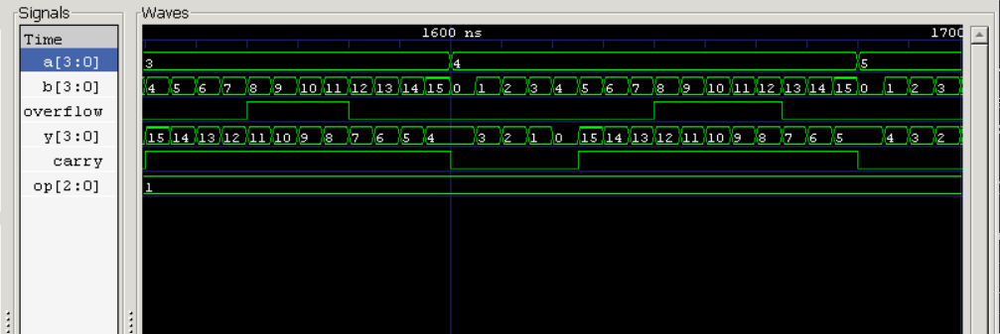

# 4-Bit ALU Design in Verilog

A combinational 4-bit Arithmetic Logic Unit with 8 operations and 4 status flags, verified with an exhaustive self-checking testbench.

## Operations

| op  | Operation | Notes |
|-----|-----------|-------|
| 000 | ADD       | carry = carry-out |
| 001 | SUB       | carry = borrow |
| 010 | AND       | |
| 011 | OR        | |
| 100 | XOR       | |
| 101 | NOT A     | |
| 110 | SHL A     | carry = bit shifted out |
| 111 | SHR A     | carry = bit shifted out |

Flags: `carry`, `overflow` (signed, ADD/SUB only), `zero`, `negative`.

## Project structure
- `rtl/alu_4bit.v` - ALU design
- `tb/tb_alu_4bit.v` - exhaustive testbench (8 ops x 16 x 16 = 2048 vectors)

## Run
```
iverilog -o alu_sim rtl/alu_4bit.v tb/tb_alu_4bit.v
vvp alu_sim
gtkwave alu.vcd
```

## Results
2048 vectors tested, 0 errors.



*SUB operation (op=001): the result wraps modulo 16, carry shows borrow, overflow flags signed overflow.*

## Tools
Icarus Verilog, GTKWave